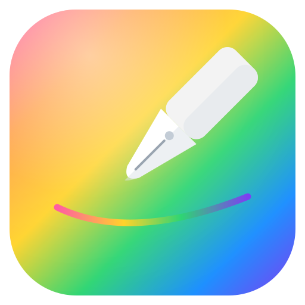

# Draw

<p align="center">
  
</p>

O Draw é uma mesa digitalizadora sem mesa digitalizadora.
Uma webcam aponta para a mesa, a pessoa desenha numa folha de papel e o sistema reproduz o desenho no digital.
A visão completa fica em [VISION.md](VISION.md).

Estado atual: a captura funciona e roda em tempo real na mesa do autor. A detecção de folha ainda é frágil em uso contínuo. A trilha neural está em construção e ainda não substitui o detector clássico.

## Início rápido

Pré-requisitos gerais: Python 3.10 ou mais novo e uma webcam.

```bash
pip install -r requirements.txt
```

### Windows com WSL

O WSL2 não enxerga a webcam do Windows por padrão. Nenhum `/dev/video*` existe dentro dele até a câmera ser anexada.

O guia completo de instalação fica em [docs/SETUP_WINDOWS.md](docs/SETUP_WINDOWS.md). O caminho curto é um comando só, rodado de dentro do WSL:

```bash
bash scripts/setup_camera_wsl.sh
python main.py
```

O script prepara o usbipd, anexa a câmera ao WSL e confere o resultado. Ele também corrige o grupo `video` do usuário e religa os serviços de áudio que ele mesmo parou.

Se algo falhar, rode o diagnóstico antes de mexer em outra coisa:

```bash
python main.py --check
```

### Linux puro com câmera USB

Conecte a webcam e rode:

```bash
python main.py
python main.py --check
```

O comando com `--check` valida o OpenCV, a existência de `/dev/video*`, a permissão do processo sobre o dispositivo e a leitura de um quadro real. Cada falha sai nomeada, com a correção na linha seguinte.

## Uso

```bash
# Modo padrão, sem marcadores, em qualquer folha ou página de caderno
python main.py

# Outra webcam local
python main.py --source 1

# Câmera via rede, por um stream MJPEG
python main.py --source http://192.168.0.10:8080/video

# Valida a câmera e sai, sem abrir janela
python main.py --check

# Modo opcional com a folha-modelo impressa
python template/generate_template.py
python main.py --markers
```

Teclas dentro do app:

- `s` salva o canvas digital como PNG em `captures/`
- `f` salva o frame cru atual em `captures/frames/`
- `g` liga ou desliga a captura automática, um frame cru a cada 10 quadros
- `q` ou `Esc` sai

O modo padrão é o sem marcadores. Ele é o padrão desde a v0.2. O modo com marcadores continua disponível atrás da flag `--markers` e pede a folha-modelo impressa com quatro marcadores ArUco.

## Como a detecção funciona hoje

A detecção atual é visão computacional clássica, em OpenCV. Ela tem duas etapas.

A primeira etapa propõe candidatos por geometria. O frame passa por Canny e pela árvore completa de contornos. Os maiores contornos viram candidatos quando fecham um quadrilátero convexo, com área de pelo menos 12% do frame e razão de aspecto entre 0,4 e 2,5. A aproximação do polígono usa uma escada de epsilons, porque cantos arredondados e a lombada de um caderno não fecham num epsilon só. Os cantos aceitos ganham refino subpixel. No loop do app, a detecção roda de forma espaçada e os cantos passam por estabilização temporal.

A segunda etapa é um portão de textura. Ele mede o interior de cada candidato e devolve um de três vereditos:

- `paper`: o interior parece papel
- `blank_maybe`: o candidato é branco o bastante, mas liso demais para afirmar papel
- rejeitado: o candidato nem branco o bastante é

O portão mede três coisas no interior encolhido do candidato. Ele mede a fração de branco, a densidade de bordas internas e a variância do Laplaciano. Um candidato vira `paper` quando a fração de branco passa de 0,5, a variância do Laplaciano passa de 30 e uma das duas condições de textura vale: densidade de bordas de pelo menos 0,03 ou variância do Laplaciano de pelo menos 200. Um candidato reprovado não encerra a busca. O contorno seguinte ainda pode ser a folha.

Um candidato `blank_maybe` recebe tratamento mais duro no app. Ele precisa do dobro de detecções consistentes para travar, 6 em vez de 3. Enquanto a trava vem desse veredito, a tela mostra o aviso de baixa confiança.

A limitação conhecida é a folha totalmente em branco e lisa. Por dentro, ela mede igual a qualquer outro retângulo branco e liso, como uma bandeja branca. Nenhuma estatística de interior separa os dois casos. Quem separa é identidade de objeto, e identidade de objeto se aprende. Essa é uma das razões da trilha neural.

O histórico explica o portão. A versão só geométrica aceitava qualquer quadrilátero convexo grande. Numa auditoria com 10 cenas sintéticas sem papel nenhum, ela disparou em 6. Tapete de mesa, caixa de papelão, monitor e bandeja branca viraram folha. O portão de textura cortou esses casos nas cenas medidas, sem modelo nenhum. Os limiares atuais são calibração de laboratório, feita sobre cenas sintéticas e um frame real. Eles precisam ser refeitos com capturas reais.

Depois da detecção, o pipeline retifica a folha por homografia para a vista de cima. Um limiar adaptativo separa a tinta do papel nessa vista. O resultado aparece como canvas digital ao lado da câmera. Apagar com a borracha funciona de forma natural. A tinta some do papel e some do canvas no frame seguinte.

## Trilha neural

A direção do projeto é trocar a detecção artesanal por um modelo que reconheça papel como objeto. O plano usa o detector clássico como professor. O app captura frames crus da mesa com as teclas `f` e `g`. O rotulador roda o detector clássico nesses frames e grava os cantos, com imagens de revisão para conferência humana. Esses frames rotulados viram dataset de treino, junto de datasets reais de documentos. Todo o treinamento roda no Kaggle, em GPU ou TPU, e os frames reais do usuário ficam em datasets privados. A arquitetura alvo é segmentação de papel com um sinal de presença, para o sistema aprender também a dizer que não há papel na cena. Os modelos treinados só em dados sintéticos já falharam no frame real, com erro médio de centenas de pixels. O gap entre o sintético e a mesa real é o problema que essa trilha ataca agora.

## Arquitetura

A árvore do repositório, pasta por pasta:

- `draw/`: o pacote principal. `app.py` tem o loop da webcam, as janelas e as validações de câmera. `paper.py` tem a detecção de folha, o portão de textura e a homografia. `ink.py` extrai a tinta e renderiza o canvas digital. `config.py` guarda o tamanho da folha retificada e os dados dos marcadores.
- `template/`: o gerador da folha-modelo imprimível, usado só pelo modo `--markers`. O PNG gerado não entra no versionamento.
- `bridge/`: a ponte de captura no Windows. Um `ffmpeg.exe` no Windows serve a webcam como stream MJPEG e o Draw consome pelo `--source`. É a rota reserva e nunca foi testada numa máquina real. O passo a passo fica em [bridge/README.md](bridge/README.md).
- `scripts/`: os scripts de instalação. Hoje guarda `setup_camera_wsl.sh`, o instalador da câmera do WSL.
- `tests/`: os testes sem webcam. Hoje guarda `selftest.py`, que valida detecção, homografia, extração de tinta e o portão de textura em cenas sintéticas.
- `tools/`: as ferramentas de apoio. Hoje guarda `label_frames.py`, o rotulador da trilha neural.
- `verification/`: o registro da verificação formal limitada da v0. Guarda a skill do projeto e o script que prova propriedades da homografia com sondas numéricas. É um registro histórico de uma etapa concluída, não uma etapa do pipeline.
- `docs/`: a documentação de instalação. Guarda o guia do Windows com WSL em [docs/SETUP_WINDOWS.md](docs/SETUP_WINDOWS.md).
- `main.py`: o ponto de entrada. Ele só chama o app.
- `VISION.md`: o documento de visão do projeto.

## Desenvolvimento

Sem webcam por perto, o pipeline inteiro se valida com cenas sintéticas:

```bash
python tests/selftest.py
```

O selftest roda os casos com marcadores, sem marcadores, de folha aninhada e do portão de textura. Ele imprime o erro máximo de canto e o recall de tinta de cada caso. Todos precisam passar antes de qualquer publicação.

Para rotular frames capturados:

```bash
python tools/label_frames.py captures/frames dataset/rotulos
```

A saída é um `labels.json` com os frames rotulados e os rejeitados. Cada frame rotulado ganha uma imagem de revisão na subpasta `overlays`. Os frames de origem nunca são modificados.

## Roadmap

Feito:

- Captura em tempo real: folha retificada, tinta extraída e canvas digital ao vivo
- Fonte de vídeo flexível, por índice local ou por URL de stream
- Câmera do Windows anexada ao WSL pelo script de instalação
- Diagnóstico de câmera porta por porta com `--check`
- Detecção sem marcadores como modo padrão
- Portão de textura com veredito de baixa confiança para folha lisa
- Captura de frames crus e rotulador do professor clássico

Em andamento:

- Teste da detecção em uso contínuo na mesa real
- Reconhecimento de datasets reais de documentos para o treino de segmentação
- Coleta de frames reais da mesa, com papel e sem papel

Planejado:

- Segmentação de papel treinada no Kaggle, com sinal de presença
- Traço vetorial, com ordem, caminho e suavização dos traços
- Reprodução dos traços em aplicativos de desenho
- Interpretação de formas, letras e diagramas
- Integração com um primeiro sistema alvo, CAD ou simulador
- Feedback de simulação em tempo real
